  <strong>Curated index of state-of-the-art AI search engines, neural information retrieval (Neural IR), vector databases, and enterprise semantic discovery platforms.</strong>

  
  
  
  
  
  

---

[📖 Overview](#-sector-overview--market-dynamics) • [🏢 SaaS & Cloud Platforms](#-enterprise--saas-ai-search-platforms) • [🔓 Open-Source Search](#-open-source-ai-search-engines--frameworks) • [💡 Key Concepts](#-key-technologies--architectures) • [💖 Support](#-support) • [⭐ Star History](#-star-history) • [🤝 Contributing](#-contributing)

---

## 📑 Table of Contents

- [🌐 Sector Overview & Market Dynamics](#-sector-overview--market-dynamics)
- [🏢 Enterprise & SaaS AI Search Platforms](#-enterprise--saas-ai-search-platforms)
- [🔓 Open-Source AI Search Engines & Frameworks](#-open-source-ai-search-engines--frameworks)
- [💡 Key Technologies & Architectures](#-key-technologies--architectures)
- [💖 Support](#-support)
- [⭐ Star History](#-star-history)
- [🤝 Contributing](#-contributing)
- [📜 License](#-license)

---

## 🌐 Sector Overview & Market Dynamics

The global enterprise AI search and cognitive discovery market is projected to expand from **~$5.5 billion in 2024 to over $17.8 billion by 2030 (CAGR ~21.5%)**, propelled by enterprise adoption of Large Language Models (LLMs), neural re-ranking, and retrieval-augmented generation (RAG). 

Market concentration remains **moderately fragmented**: incumbent mega-cap cloud and workflow giants (Microsoft Azure AI Search, ServiceNow, AWS Kendra, Google Cloud Vertex Search) retain substantial enterprise distribution and governed data access, while agile, search-native specialty innovators (Elastic, Algolia, Pinecone, Coveo) dominate high-throughput e-commerce catalog discovery, developer-first APIs, and low-latency vector infrastructure.

---

## 🏢 Enterprise & SaaS AI Search Platforms

*Ranked in descending order by company scale (enterprise market capitalization or private venture valuation).*

| Platform | Company Scale (Revenue / Valuation) | Pricing (Specific Starting Tiers) | Free Tier Limits (Perpetual / Trial Quotas) | Key Capabilities & Architecture |
| :--- | :--- | :--- | :--- | :--- |
| **[Microsoft Azure AI Search](https://azure.microsoft.com/en-us/products/ai-services/ai-search/)** | **$3.1T Market Cap** *(Microsoft Corp.)* | **$73.00/month** (Basic tier; standard units scale from $248.20/month per search unit) | **Perpetual Free Tier**: 50 MB total storage, maximum 3 indexes, 3 indexers, up to 10,000 documents per index | Enterprise hybrid search combining BM25 keyword matching, vector similarity search, and semantic re-ranking with deep Microsoft 365 / Azure OpenAI integrations. |
| **[Amazon Kendra](https://aws.amazon.com/kendra/)** | **$2.0T Market Cap** *(Amazon.com, Inc.)* | **$810.00/month** ($1.125/hour Developer Edition base unit; Enterprise Edition starts at $1.40/hour base) | **30-Day Free Trial**: Up to 750 hours over the first 30 days of Developer Edition usage (includes up to 10,000 documents and 4,000 queries/day) | Intelligent enterprise work search engine powered by machine learning, automated connectors for SharePoint/Salesforce/S3, and natural language question-answering. |
| **[ServiceNow Now Assist (AI Search)](https://www.servicenow.com/products/ai-search.html)** | **$190B Market Cap** *(ServiceNow, Inc.)* | **$100.00/user/month** (Enterprise add-on bundle; Now Assist consumption packs start at $5,000/pack per year for LLM generation tokens) | **30-Day Free Trial**: Full-featured ServiceNow Developer Instance (PDI) with AI Search plugin pre-activated for sandbox testing and zero-dollar API prototyping | Unified enterprise knowledge discovery across ITSM, customer workflows, and HR documentation with contextual intent comprehension and genAI summarization. |
| **[Elastic Cloud](https://www.elastic.co/pricing)** | **$9.5B Market Cap** *(Elastic N.V.)* | **$95.00/month** (Elasticsearch Service Standard tier on AWS/GCP/Azure; compute billed from ~$0.13/hour) | **14-Day Free Trial**: Complete access to Elasticsearch Service on AWS, GCP, or Azure with up to $300 in cloud credits, no credit card required upfront | Industry standard distributed search engine offering vector database capabilities, ELSER sparse embeddings, hybrid search, and log/APM observability. |
| **[Algolia Search](https://www.algolia.com/pricing/)** | **$2.25B Valuation** *(Last private financing round)* | **$0.50/1,000 search requests** beyond free allowance (Grow Tier starting price; Premium plans start at ~$1,500/month) | **Perpetual Free Tier**: 10,000 search requests/month, 10,000 records index capacity, full access to Algolia AI NeuralSearch & instant search widgets | Lightning-fast millisecond search-as-a-service with AI NeuralSearch, typo tolerance, dynamic facet filters, and e-commerce personalization algorithms. |
| **[Coveo](https://www.coveo.com/en/pricing)** | **$650M Market Cap** *(Toronto Stock Exchange: CVO)* | **$1,250.00/month** (Pro plan base subscription for departmental search; Enterprise custom contracts scale higher) | **30-Day Free Trial**: Sandbox trial environment featuring 50,000 indexed items, Coveo Relevance Generative Answering, and pre-built Salesforce/ServiceNow connectors | AI-orchestrated relevance engine delivering intelligent search, generative answering, contextual recommendations, and personalized merchandise filtering. |
| **[Pinecone](https://www.pinecone.io/pricing/)** | **$750M Valuation** *(Series B financing)* | **$0.33/million read units** + **$0.096/GB-month storage** (Serverless Standard tier pay-as-you-go) | **Perpetual Free Tier (Starter)**: 1 serverless project, up to 2 GB storage (~100,000 1536-dim vectors), and 2 million read units per month | Fully managed serverless vector database engineered for fast vector indexing, ultra-low latency RAG retrieval, and real-time metadata filtering at scale. |

---

## 🔓 Open-Source AI Search Engines & Frameworks

*Ranked in descending order by GitHub stargazers count.*

| Repository | GitHub Stars | Core Language / Stack | Architecture & Description |
| :--- | :---: | :--- | :--- |
| **[langchain-ai/langchain](https://github.com/langchain-ai/langchain)** |  | Python / TypeScript | Flagship orchestrator and agentic framework connecting retrieval engines, vector databases, and foundational models for RAG pipelines. |
| **[infiniflow/ragflow](https://github.com/infiniflow/ragflow)** |  | Python / C++ | Next-generation open-source RAG engine based on deep document understanding, multi-modal layout analysis, and grounded citation generation. |
| **[elastic/elasticsearch](https://github.com/elastic/elasticsearch)** |  | Java | Distributed, multitenant-capable full-text search engine with native HNSW dense vector indexing, learned sparse models (ELSER), and Lucene roots. |
| **[meilisearch/meilisearch](https://github.com/meilisearch/meilisearch)** |  | Rust | Ultra-fast, lightweight search engine featuring out-of-the-box typo tolerance, AI-powered semantic search, and hybrid vector search integrations. |
| **[run-llama/llama_index](https://github.com/run-llama/llama_index)** |  | Python / TypeScript | Data framework and query engine designed for ingesting, indexing, and executing complex search and contextual retrieval over external knowledge bases. |
| **[milvus-io/milvus](https://github.com/milvus-io/milvus)** |  | Go / C++ / Python | Cloud-native, distributed vector database engineered to manage billions of embedding vectors with hardware-accelerated GPU search indexes. |
| **[searxng/searxng](https://github.com/searxng/searxng)** |  | Python | Privacy-respecting, hackable metasearch engine aggregating results from over 70 search services with built-in API support for AI agent tooling. |
| **[qdrant/qdrant](https://github.com/qdrant/qdrant)** |  | Rust | High-performance vector similarity search engine and database with extended payload filtering support and quantization capabilities. |
| **[chroma-core/chroma](https://github.com/chroma-core/chroma)** |  | Python / Rust | The AI-native open-source embedding database designed for developer ergonomics, local experimentation, and production RAG backend storage. |
| **[typesense/typesense](https://github.com/typesense/typesense)** |  | C++ | Fast, typo-tolerant search engine optimized for developer happiness; provides native vector search, hybrid ranking, and conversational search. |
| **[pgvector/pgvector](https://github.com/pgvector/pgvector)** |  | C / SQL | Open-source vector similarity search extension for PostgreSQL; supports exact nearest neighbor, IVFFlat, and HNSW index graphs within standard Postgres tables. |
| **[weaviate/weaviate](https://github.com/weaviate/weaviate)** |  | Go | Cloud-native, open-source modular vector search engine capable of storing both objects and vectors with built-in machine learning model vectorizers. |
| **[quickwit-oss/quickwit](https://github.com/quickwit-oss/quickwit)** |  | Rust | Sub-second distributed search engine decoupled on cloud object storage (Amazon S3 / Google Cloud Storage) with native Tantivy index structures. |
| **[vespa-engine/vespa](https://github.com/vespa-engine/vespa)** |  | C++ / Java | Battle-tested AI search, vector search, and recommendation engine processing petabyte-scale data with multi-phase ranking pipelines. |
| **[apache/lucene](https://github.com/apache/lucene)** |  | Java | Foundational open-source search library powering Elasticsearch, Solr, and OpenSearch with modern vector index (HNSW) primitives. |

---

## 💡 Key Technologies & Architectures

- **Hybrid Search (Sparse + Dense)**: Synthesizes lexical BM25 token matching with dense vector embeddings to achieve robust exact keyword recall alongside deep semantic conceptual understanding.
- **Hierarchical Navigable Small World (HNSW)**: Graph-based indexing algorithm providing logarithmic time-complexity search traversal across high-dimensional vector representations.
- **Cross-Encoder Re-Ranking**: Neural re-scoring pass (e.g., Cohere Rerank, BGE-Reranker) applied to top-$K$ candidate documents for precise relevance calibration.
- **Retrieval-Augmented Generation (RAG)**: Grounding LLM responses in real-time, governed enterprise corpora through structured semantic retrieval pipelines.
- **Multimodal Embedding Spaces**: Unified vector embeddings (e.g., CLIP, ColPali) bridging structured text, document page layouts, diagrams, and image catalog searches.

---

## 🤝 Contributing

Contributions are always welcome! 💖

1. 🍴 Fork the repository.
2. 🌿 Create your feature branch (`git checkout -b feature/awesome-addition`).
3. 💾 Commit your changes (`git commit -m 'feat: add exciting AI search project'`).
4. 🚀 Push to the branch (`git push origin feature/awesome-addition`).
5. 📬 Open a Pull Request.

---

## 💖 Support

Thank you for exploring **Awesome AI Search**! If this repository helped you discover search technologies, compare enterprise solutions, or accelerate your AI projects, please consider supporting its ongoing curation and development:

- ⭐ **Star this repository** to help others discover it across GitHub.
- 🍴 **Fork and contribute** by suggesting new engines, features, and corrections.
- 📢 **Share with your network** on X/Twitter, LinkedIn, and developer communities.
- ☕ **Buy me a coffee / Sponsor**: If you'd like to back this work financially, visit my [Sponsor Dashboard](https://github.com/sponsors/ishandutta2007) — every bit of support is deeply appreciated!

---

##  Star History

---

## 📜 License

This project is licensed under the [MIT License](LICENSE) © 2026 Ishan Dutta.
